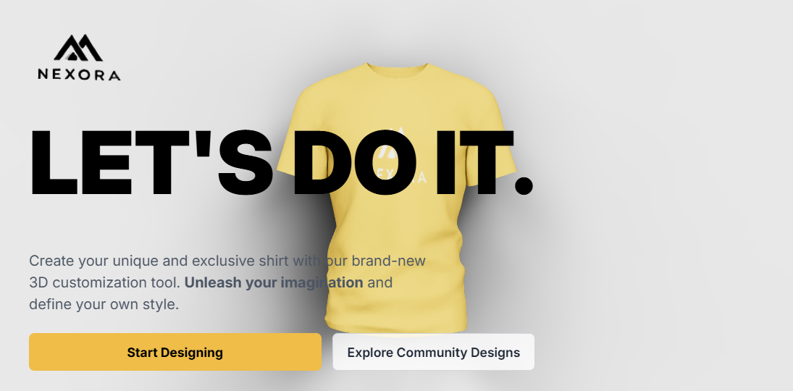

# Nexora 3D Shirt Customizer

Nexora is a browser-based 3D shirt design app. Customize a shirt's color, add your own artwork or an AI-generated design, preview it on the 3D model, and download the result.



## Features

- Interactive 3D shirt preview
- Change the shirt color
- Upload an image and place it as a logo or full-shirt design
- Generate artwork from a text prompt using the image-generation API
- Browse community design examples
- Download the customized shirt preview as a PNG

## Tech stack

- **Client:** React, Vite, Three.js, React Three Fiber, Tailwind CSS
- **State and animation:** Valtio and Framer Motion
- **API:** Express and the OpenAI Node SDK

## Getting started

You need Node.js and npm installed.

### Run the client

From the repository root:

```sh
cd client
npm install
npm run dev
```

Open the local URL printed by Vite (typically `http://localhost:5173`).

### Enable AI image generation (optional)

The client can be used for shirt color changes and uploaded designs without the API. To enable AI-generated artwork, start the Express server in a second terminal:

```sh
cd server
npm install
npm start
```

The API listens on `http://localhost:8080`. Set an OpenAI API key in `server/.env` or the repository-root `.env`:

```env
OPENAI_API_KEY=your_openai_api_key
```

Restart the server after adding the key. The client sends generation requests to the local API during development.

### Deploy the API to Vercel

Create or configure the Vercel project with `server` as its **Root Directory**. This makes `server/vercel.json` the project configuration and `index.js` the serverless function entry point. Add `OPENAI_API_KEY` as a Vercel environment variable before deploying.

## Project structure

```text
client/   React and Vite application, 3D assets, and static images
server/   Express API for AI image generation
```